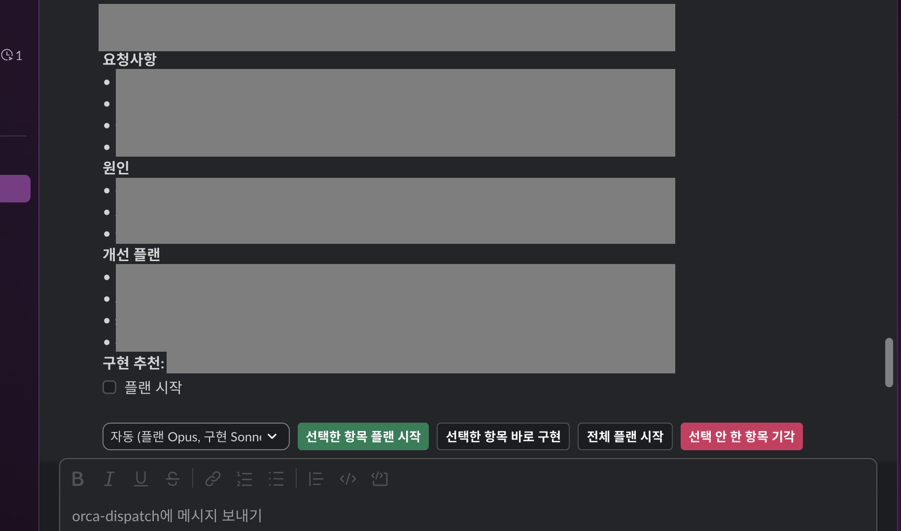

# @lodado/slack-dispatch

Slack에서 나를 태그한 글을 모아 DM 한 통으로 정리해 주고, 내가 고른 항목만 코드 수정부터 PR까지 이어 주는 개인용 봇이에요. 글을 읽고, 어느 레포 일인지 정하고, 고치고, PR을 올리는 일은 Claude Code가 맡아요. 다음 단계로 넘어갈지는 매번 내가 Slack DM의 버튼으로 정해요.

[이 서비스가 하는 일](#이-서비스가-하는-일) · [화면으로 보기](#화면으로-보기) · [미리 알아 둘 것](#미리-알아-둘-것) · [준비물](#준비물) · [설치하고 켜는 방법](#설치하고-켜는-방법) · [Claude 연결하기](#claude-연결하기) · [사용법과 프롬프트 예시](#사용법과-프롬프트-예시) · [비용과 한도](#비용과-한도) · [안전하게 쓰는 방법](#안전하게-쓰는-방법) · [설정 값](#설정-값) · [문제가 생겼을 때](#문제가-생겼을-때) · [개발](#개발)

## 이 서비스가 하는 일

```text
Slack에서 나를 태그한 글
   │  5분마다 검색
   ▼
다이제스트 DM   항목마다 요청사항 · 원인 · 개선 플랜 · 구현 추천
   │  내가 항목과 모델을 고르고 버튼을 누름
   ▼
플랜 카드 ─ 내가 승인 ─▶ 구현 ─▶ Visual QA ─▶ PR ─ 내가 머지 클릭, CI와 리뷰 통과 ─▶ 머지
        (Orca worktree 안에서 claude -p 가 작업)
```

일은 세 곳에 나뉘어 있어요.

| 누가     | 하는 일                                                             |
| -------- | ------------------------------------------------------------------- |
| 나       | 항목 고르기, 모델 고르기, 플랜 승인, 머지 클릭                      |
| 코드     | Slack 검색, 레포 정하기, 상태 전환, 비용 한도, 머지 조건 확인, 로그 |
| 에이전트 | 글 요약, 플랜 작성, 구현, 화면 캡처 판정                            |

에이전트는 코드로 정할 수 없는 일에만 불러요. 돈, 순서, 권한이 걸린 판단은 코드가 해요.

순서는 이래요.

1. 모으기: 5분마다 Slack에서 나를 태그한 글을 검색해요. 어느 레포 일인지는 규칙으로 정해요. 글에 걸린 GitHub 링크를 먼저 보고, 없으면 본문에 적힌 레포 이름(5자 이상)을 보고, 그것도 없으면 채널별 표를 봐요. 봇이 쓴 글과 이미 내가 직접 답한 글은 건너뛰어요.
2. 다이제스트 DM: 새 항목마다 요청사항, 원인, 개선 플랜을 2~4줄씩 짧게 정리하고 구현 추천 O/X를 붙여서 DM 한 통으로 보내요. 가장 싼 모델(Haiku)이 레포를 읽기 전용으로 훑어서 만들어요. 추천이 O인 항목은 미리 체크돼 있어요.
3. 플랜: 체크한 항목마다 Orca worktree를 만들고, Claude Code를 플랜 모드로 돌려서 플랜 카드를 보내요. 카드의 스레드에 답글을 달면 그 내용으로 플랜을 다시 써요. 구현이 도는 동안 같은 스레드에 답글을 달면 진행 상황을 알려 줘요.
4. 구현: 플랜을 승인하면 의존성 설치, 코드 수정, 커밋, Visual QA 순서로 진행해요. Visual QA는 바뀐 화면을 띄워 스크린샷을 찍고, 모델이 그 이미지를 보고 판정해요. Playwright e2e 설정이 있는 레포는 에이전트가 쓴 spec 하나를 `test:e2e`로 돌리고, 그 밖의 레포는 `dev:msw`, `dev:mock`, `dev` 중 처음 있는 스크립트로 dev 서버를 띄워요. 화면 파일(tsx, css 등)이 바뀌지 않았으면 QA를 건너뛰어요. 구현이 시작되면 Orca의 그 worktree에 "구현 진행 보기" 터미널 탭이 백그라운드로 열려서 바뀐 파일을 보여 줘요. 에이전트는 Orca가 보여 줄 수 없는 백그라운드 프로세스라서 이 탭이 따로 있어요. 탭은 포커스를 가져가지 않아요.
5. PR: `ENABLE_PR=1`일 때만 push하고 PR을 열어요. PR이 열리면 일이 시작된 스레드(DM 요청이면 내 DM 메시지)에 "구현을 마쳤어요. PR: 주소"라고 답글을 달아요. 머지는 내가 카드의 머지 버튼을 누르고 CI와 리뷰가 통과했을 때만 돼요. 10분마다 GitHub에 대기 중인 PR의 상태를 물어봐서, GitHub에서 직접 머지한 PR도 항목을 끝내고 worktree를 지워요. 머지 없이 닫힌 PR은 기각으로 처리해요.

태그된 글 말고 봇에게 DM으로 직접 요청해도 돼요. 요청은 레포별로 나뉘어 곧바로 플랜 단계로 가요. 자세한 방법은 [사용법과 프롬프트 예시](#사용법과-프롬프트-예시)에 있어요.

## 화면으로 보기



봇이 보낸 다이제스트 DM이에요. 스크린샷에서 가린 부분은 실제 스레드의 내용이에요(레포와 채널 이름, 요청사항과 원인과 개선 플랜의 문장). 항목 아래에 있는 컨트롤은 이렇게 써요.

| 컨트롤                | 하는 일                                                                                                     |
| --------------------- | ----------------------------------------------------------------------------------------------------------- |
| 플랜 시작 체크박스    | 항목마다 있어요. 구현 추천이 O인 항목은 미리 체크돼 있어요                                                  |
| 모델 메뉴             | 자동은 플랜을 Opus로, 구현을 Sonnet으로 해요. Opus, Sonnet, Haiku를 고르면 플랜과 구현이 모두 그 모델이에요 |
| 선택한 항목 플랜 시작 | 체크한 항목의 플랜을 만들어요. 플랜을 보고 승인하면 구현이 시작돼요                                         |
| 선택한 항목 바로 구현 | 다이제스트에 적힌 개선 플랜대로 플랜 단계 없이 바로 구현해요                                                |
| 전체 플랜 시작        | 체크와 상관없이 다이제스트의 모든 항목에 플랜을 만들어요                                                    |
| 선택 안 한 항목 기각  | 체크하지 않았고 아직 대기 중인 항목을 기각해요                                                              |

## 미리 알아 둘 것

### Orca

Orca는 Claude Code, Codex 같은 코딩 에이전트를 여러 개 동시에 돌리는 데스크톱 앱이에요. 공식 소개로는 Agent Development Environment(ADE)이고, 무료 오픈소스예요. 에이전트마다 따로 떨어진 작업 폴더(worktree)를 줘서, 에이전트 여러 개가 같은 레포에서 일해도 서로의 파일을 건드리지 않아요. 홈페이지는 https://www.onorca.dev, 코드는 https://github.com/stablyai/orca 에 있어요.

slack-dispatch는 Orca를 이렇게 써요.

| 하는 일                                | 쓰는 Orca 명령                                |
| -------------------------------------- | --------------------------------------------- |
| 작업할 수 있는 레포 목록 읽기          | `orca repo list`                              |
| 항목마다 worktree 만들기와 이름 붙이기 | `orca worktree create`, `orca worktree set`   |
| "구현 진행 보기" 탭 열고 닫기          | `orca terminal create`, `orca terminal close` |
| 끝난 항목의 worktree 지우기            | `orca worktree rm`                            |

그래서 Orca 앱이 켜져 있어야 하고, 작업시킬 레포가 Orca에 등록돼 있어야 해요. Orca 앱에서 레포를 추가하거나 터미널에서 이렇게 등록해요.

```sh
orca repo add --path ~/code/web-app
orca repo list    # 등록된 레포 이름이 나와요. 이 이름이 라우팅에 쓰는 레포 이름이에요
```

Orca가 꺼져 있으면 서비스는 바로 종료해요. 자동 시작으로 켠 경우에는 launchd가 30초마다 다시 시도해요.

### worktree

`git worktree`는 git 기본 기능이에요. 레포 하나를 공유하면서 작업 폴더를 여러 개 만들고, 폴더마다 다른 브랜치를 꺼내 둘 수 있어요. 내가 쓰는 폴더는 그대로 두고 옆에 새 폴더를 하나 파서 거기서만 고치는 식이에요. 봇은 항목 하나당 worktree와 브랜치를 하나 만들고, 항목이 머지되거나 기각되면 worktree를 지워요. 커밋은 브랜치에 남을 수 있어요.

### Claude Code

Claude Code는 터미널에서 쓰는 Anthropic의 코딩 에이전트예요. 이 서비스는 항목마다 `claude -p`(대화창 없이 한 번 실행하고 결과를 받는 모드)를 Orca worktree 안에서 실행해요. 한 항목의 플랜, 수정 요청, 구현은 세션 하나를 이어 써서 앞에서 한 이야기를 기억해요. 다이제스트 요약, DM 요청 나누기, Visual QA 판정은 새 세션으로 따로 돌려요.

### Socket Mode

웹훅은 Slack이 내 서버 주소로 이벤트를 보내 주는 방식이에요. Socket Mode는 이 서비스가 Slack에 먼저 연결을 걸어 두는 방식이에요. 공개 주소가 필요 없어서 서버나 터널 없이 내 맥 한 대로 돌 수 있어요.

## 준비물

| 프로그램                 | 쓰는 곳                                                | 확인                 |
| ------------------------ | ------------------------------------------------------ | -------------------- |
| macOS                    | 키체인에 토큰 저장, 로그인할 때 자동 시작(LaunchAgent) | `sw_vers`            |
| Node.js 24.15 이상, pnpm | 서비스 실행 (`.nvmrc` 참고)                            | `node -v`, `pnpm -v` |
| git                      | worktree, 커밋                                         | `git --version`      |
| Orca                     | 레포와 worktree 관리                                   | `orca status`        |
| Claude Code              | 플랜과 구현                                            | `claude --version`   |
| GitHub CLI               | PR 열기, 머지, PR 상태 확인                            | `gh auth status`     |

`service:install`은 node, pnpm, claude, orca, gh, git, security가 PATH에 있어야 해요. 없는 것이 있으면 이름을 알려 주고 멈춰요. Slack 워크스페이스에서는 앱을 만들 수 있어야 해요. 관리자 승인이 필요한 워크스페이스라면 설치 전에 승인을 받아요.

## 설치하고 켜는 방법

### 1. 코드 받기

```sh
git clone https://github.com/lodado/shareds.git
cd shareds
pnpm install
cd packages/slack-dispatch
```

이 폴더에서 아래 명령을 모두 실행해요.

### 2. Orca에 레포 등록

[Orca](#orca)에서 설명한 대로 Orca 앱을 켜고, 작업시킬 레포를 등록해요. `orca repo list`에 레포가 보이면 끝나요.

### 3. Slack 앱 만들기

1. https://api.slack.com/apps 에서 Create New App을 누르고 From a manifest를 골라요. 워크스페이스를 고르고 아래 YAML을 붙여 넣은 뒤 Create를 눌러요.
2. Basic Information의 App-Level Tokens에서 Generate Token and Scopes를 눌러요. 이름은 아무거나 쓰고 scope에 `connections:write`를 넣어요. 만들어진 `xapp-` 토큰을 복사해 둬요.
3. Install App에서 Install to Workspace를 눌러요. OAuth & Permissions에 `xoxb-`로 시작하는 Bot User OAuth Token과 `xoxp-`로 시작하는 User OAuth Token이 나와요. 복사해 둬요.

```yaml
display_information:
  name: orca-dispatch
features:
  app_home:
    home_tab_enabled: false
    messages_tab_enabled: true
    messages_tab_read_only_enabled: false
  bot_user:
    display_name: orca-dispatch
    always_online: false
oauth_config:
  scopes:
    user:
      - search:read
      - channels:history
      - groups:history
      - im:history
      - mpim:history
    bot:
      - chat:write
      - im:write
      - im:history
settings:
  event_subscriptions:
    bot_events:
      - message.im
  interactivity:
    is_enabled: true
  org_deploy_enabled: false
  socket_mode_enabled: true
  token_rotation_enabled: false
```

권한이 왜 필요한지는 이래요.

| 토큰           | scope                                | 쓰는 곳                                                           |
| -------------- | ------------------------------------ | ----------------------------------------------------------------- |
| User (`xoxp-`) | `search:read`                        | 나를 태그한 글 검색                                               |
| User (`xoxp-`) | `channels:history`, `groups:history` | 공개 채널과 비공개 채널의 스레드 읽기                             |
| User (`xoxp-`) | `im:history`, `mpim:history`         | DM과 그룹 DM 안에서 태그된 글 읽기. 채널 글만 볼 거면 필요 없어요 |
| Bot (`xoxb-`)  | `chat:write`, `im:write`             | 내 DM 열기, 메시지 보내기와 고치기                                |
| Bot (`xoxb-`)  | `im:history`                         | 내가 봇에게 보낸 DM 받기(`message.im` 이벤트)                     |
| App (`xapp-`)  | `connections:write`                  | Socket Mode 연결                                                  |

User 토큰은 읽기 권한만 가져요. 봇은 내 이름으로 글을 쓰지 않고, 봇 이름으로만 써요. 앱 설정 화면에서 Messages Tab, Interactivity, Socket Mode가 켜져 있는지 한 번 확인해요.

### 4. 토큰을 키체인에 넣기

```sh
security add-generic-password -U -a "$USER" -s slack-dispatch-xapp -w
security add-generic-password -U -a "$USER" -s slack-dispatch-xoxp -w
security add-generic-password -U -a "$USER" -s slack-dispatch-xoxb -w
```

`-w` 뒤에 값을 쓰지 않으면 `security`가 토큰을 입력받아요. 그래서 터미널 기록과 프로세스 목록에 토큰이 남지 않아요. 토큰은 `.env`나 다른 파일에 적지 않아요.

### 5. 설정 파일 만들기

```sh
cp .env.example .env
```

`.env`는 git에 올라가지 않아요. 처음에는 비워 둬도 돼요. `OWNER_SLACK_USER_ID`를 비우면 User 토큰의 주인이 소유자가 돼요. `ENABLE_PR`을 비우면 PR을 열지 않고 worktree에 로컬 커밋만 남겨요. 플랜과 구현이 마음에 드는지 보고 나서 `ENABLE_PR=1`로 켜면 돼요. 전체 목록은 [설정 값](#설정-값)에 있어요.

채널별로 어느 레포 일인지 미리 알려 주고 싶으면 `~/.slack-dispatch/routes.json`을 만들어요. 이 파일은 레포 밖에 있어서 git에 올라가지 않아요.

```json
{
  "channels": { "dev-web": ["web-app"] },
  "baseBranches": { "web-app": "stage" }
}
```

`channels`는 채널 이름(`#` 없이)별로 담당 레포(Orca에 등록한 이름)를 적어요. 이 파일은 검색할 때마다 다시 읽어서 고쳐도 재시작이 필요 없어요. `baseBranches`는 작업을 시작할 브랜치예요. 적지 않으면 `origin/develop`, `main`, `master` 순으로 찾아요. 이 값은 서비스를 시작할 때 읽어요.

### 6. 먼저 읽기만 해 보기

```sh
pnpm dry-run      # 오늘 나를 태그한 글을 읽고 다이제스트가 어떻게 나올지 보여 줘요
pnpm dry-run 3    # 3일 전까지
```

읽기 전용이에요. 새 항목과 다이제스트의 모양만 화면에 보여 주고(요약 모델은 부르지 않아요), Slack에는 아무것도 보내지 않고 저장도 하지 않아요.

### 7. 켜기

```sh
pnpm start
```

터미널을 열어 둬야 해요. 컴퓨터를 켤 때마다 알아서 돌게 하려면 LaunchAgent로 설치해요.

```sh
pnpm service:install     # 로그인할 때 자동 시작, 죽으면 다시 시작
pnpm service:status      # state가 running이고 health가 200이면 정상
pnpm service:restart     # 코드를 고친 뒤 새 코드로 다시 시작
pnpm service:uninstall
```

켜졌는지는 Slack에서 orca-dispatch와의 DM에 `대기`라고 보내서 확인해요. "열려 있는 항목 N개" 또는 "대기 중인 항목이 없어요."라고 답해요.

- 로그는 `~/.slack-dispatch/service.log`, 상태 저장소와 lock 파일은 `~/.slack-dispatch`에 있어요.
- 서비스가 도는 동안 `http://localhost:9814/health`와 `/status`(항목 단계별 개수, 실행 중인 작업 수, 마지막 검색 시각)가 이 컴퓨터에서만 답해요. `STATUS_PORT=0`이면 꺼져요. `service:status`는 셸 환경의 `STATUS_PORT`만 읽어서, `.env`에서 포트를 바꿨다면 `STATUS_PORT=값 pnpm service:status`로 실행해요.
- lock 파일이 있어서 같은 상태 폴더(`STATE_DIR`)로는 서비스를 두 개 켤 수 없어요. 서비스가 돌고 있을 때 `pnpm start`를 따로 켜지 않아요.
- LaunchAgent 파일에는 node와 레포 폴더의 절대 경로가 들어 있어요. node 버전을 바꾸거나 폴더를 옮기면 `service:install`을 다시 실행해요.

## Claude 연결하기

이 서비스는 같은 컴퓨터에 설치된 `claude`를 그대로 불러요. 따로 설정할 것은 설치와 로그인 두 가지예요.

```sh
npm install -g @anthropic-ai/claude-code    # brew를 쓰면: brew install --cask claude-code@latest
claude                                       # 한 번 실행해서 안내대로 로그인
```

연결됐는지는 이 명령으로 확인해요. 한 줄 답이 오면 돼요.

```sh
claude -p "한 단어로 답해: 안녕" --model haiku
```

로그인은 그 `claude`의 것을 써요. 서비스는 API 키나 로그인 관련 환경 변수를 넘기지 않아요. 서비스가 실행하는 `claude`, 의존성 설치, QA 명령에는 PATH, HOME, 사용자 이름, 셸, 임시 폴더, 터미널 종류, 로케일, 시간대, XDG 폴더, 프록시와 인증서 변수만 넘겨요. `git`, `gh`, `orca`, `security`는 서비스가 받은 환경 변수를 그대로 받아요. 그래서 push할 때 도는 git 훅도 그 환경을 봐요.

### 모델

다이제스트의 모델 메뉴로 고르고, 고르지 않으면 자동이에요.

| 메뉴              | 플랜   | 구현   |
| ----------------- | ------ | ------ |
| 자동 (`opusplan`) | Opus   | Sonnet |
| Opus              | Opus   | Opus   |
| Sonnet            | Sonnet | Sonnet |
| Haiku             | Haiku  | Haiku  |

플랜은 어떤 모델이든 항상 플랜 모드로 만들어요. 플랜 모드에서는 에이전트가 파일을 고치지 못해요.

### 에이전트가 쓸 수 있는 것

기본으로 모든 에이전트 호출에는 `--safe-mode --restricted --tools <이름 목록>`이 붙어요.

- `--safe-mode`: 내 CLAUDE.md, 스킬, 플러그인, 훅, MCP 서버를 불러오지 않아요.
- `--restricted`: 내 user, project, 폴더 설정을 무시해요. 명령을 실행하는 도구는 서비스가 목록에 적은 것만 쓰고, 파일 도구는 작업 폴더 안에서만 움직여요.

`--restricted`가 필요한 이유가 있어요. 내 설정에 `allow: ["Bash"]` 같은 규칙이 있으면, 서비스가 정확한 도구 목록을 넘겨도 모든 명령이 실행돼요. 구현 에이전트는 Edit와 Write 도구로는 `.husky/**`와 `.github/**`를 고치지 못해요.

이 제한에는 한계가 있어요. 구현 에이전트는 파일을 쓰고 `pnpm test`, `pnpm build`, `pnpm lint` 같은 스크립트를 돌릴 수 있어서, 에이전트가 쓴 코드가 내 계정 권한으로 실행돼요. 서비스도 Visual QA를 위해 에이전트가 쓴 e2e spec을 돌리고, 고친 코드로 dev 서버를 띄워요. 그 코드는 키체인(`security`로 읽으면 토큰이 나올 수 있어요), `gh` 로그인, `~/.ssh`에 닿을 수 있어요. 그래서 플랜을 승인하기 전에 원본 스레드를 읽어 보고, 믿을 수 없는 사람이 쓴 스레드에는 "바로 구현"을 쓰지 않아요.

`OWN_SETUP=1`로 켜면 플랜과 구현이 내 설정(스킬, CLAUDE.md, 플러그인, 훅, MCP)을 그대로 써요. 대신 위 보호를 포기해서 플랜과 구현에는 `--safe-mode --restricted`가 붙지 않고, 우회될 수 있는 이름 목록(`git push`, `git remote`, `gh`, `curl`, `wget`, `ssh`, `scp`, `security`, `osascript`)만 남아요. 에이전트가 읽는 글에 영향을 줄 수 있는 사람이 나 하나일 때만 켜요. 다이제스트 요약, DM 요청 나누기, Visual QA 판정은 `OWN_SETUP`과 상관없이 항상 `--safe-mode`로 돌아요.

### Claude Code에게 맡길 수 있는 일

설치와 점검은 Claude Code에게 시켜도 돼요. 토큰 입력만 직접 해요.

```text
packages/slack-dispatch/README.md의 "준비물" 표를 보고, 필요한 프로그램이 이 컴퓨터에 다 있는지 확인해 줘.
없는 건 설치 방법만 알려 주고, 토큰은 내가 직접 키체인에 넣을 테니 건드리지 마.

packages/slack-dispatch에서 pnpm service:status를 실행해서 서비스가 떠 있는지 알려 줘.

~/.slack-dispatch/service.log의 마지막 50줄을 보고 에러가 있으면 원인을 설명해 줘.
```

## 사용법과 프롬프트 예시

### 태그된 글로 시작하기

다이제스트 DM이 오면 체크박스와 모델을 고르고 버튼을 눌러요. 버튼 설명은 [화면으로 보기](#화면으로-보기)에 있어요. 처음이라면 구현 추천이 O인 항목 하나에 "선택한 항목 플랜 시작"을 눌러서 플랜 카드가 어떻게 오는지 보는 걸 권해요. 고르지 않은 항목은 그대로 기다려요.

### DM으로 직접 요청하기

봇 DM에 평소 말투로 쓰면 돼요. 싼 모델이 요청을 레포별로 나누고, 코드가 그 레포 이름이 Orca에 있는지 확인해요. 내가 직접 한 요청이라서 다이제스트를 건너뛰고 바로 플랜 단계로 가요. 한 요청에 레포는 8개까지 쓸 수 있어요.

```text
web-app 로그인 화면에서 비밀번호가 틀렸을 때 나오는 에러 문구가 영어예요. 한국어로 바꿔 줘.
```

레포 하나에 플랜 카드가 하나 와요.

```text
api-server의 /health 응답에 version 필드를 추가해 줘. web-app 푸터에는 그 버전을 보여 줘.
```

레포 둘로 나뉘어 플랜 카드가 둘 와요. 각 카드를 따로 승인하거나 기각하거나 고칠 수 있어요.

```text
design-system의 Button이 disabled일 때 hover 색이 바뀌는 문제를 고쳐 줘. 스토리도 하나 추가해 줘.
```

레포 이름은 `orca repo list`에 나오는 이름 그대로 써요. Orca에 없는 이름은 걸러지고, 걸러졌다고 DM으로 알려 줘요.

### 플랜 카드에서

카드에는 "승인하고 구현 시작"과 "기각" 버튼이 있어요. 플랜을 바꾸고 싶으면 그 카드의 스레드에 답글을 달아요. 같은 세션이 그 요청을 읽고 플랜을 다시 써서 보내 줘요. 답글을 여러 개 달면 다음 플랜에 모두 반영돼요.

```text
삭제 버튼에는 확인 창을 붙이지 말고, 실행 취소 토스트로 해 줘.
```

### 구현이 도는 동안

"바로 구현"으로 시작했다면 "바로 구현 시작" 카드가 와요. 작업 위치와 브랜치가 적혀 있고, "기각 (구현 중단)" 버튼이 있어요. 플랜 카드나 이 카드의 스레드에 답글로 물으면 진행 상황을 알려 줘요. 구현이 도는 중에는 답글이 플랜을 바꾸지 않아요.

```text
지금 어디까지 했어?
```

### 끝난 뒤

PR 카드에 PR 링크, 구현 보고, Visual QA 결과 한 줄이 와요. 머지 버튼은 CI와 리뷰가 통과했을 때만 동작해요. 아직이면 "CI나 리뷰가 아직 통과하지 않았어요."라고 답해요. 기각해도 열려 있는 PR은 GitHub에서 직접 닫아야 해요. `ENABLE_PR`이 꺼져 있으면 PR 대신 "구현 완료" 카드가 오고 "폐기 (워크트리 삭제)" 버튼만 있어요. 폐기하면 worktree를 지우고 커밋은 브랜치에 남을 수 있어요. 구현이 실패하면 실패 카드가 오고, 재시도 횟수와 비용 한도가 남아 있으면 "다시 시도" 버튼이 있어요.

### DM 명령

| 보내는 말                                      | 하는 일                                                                                                  |
| ---------------------------------------------- | -------------------------------------------------------------------------------------------------------- |
| `대기` (`상태`, `status`, `list`도 같아요)     | 열려 있는 항목과 단계를 보여 줘요                                                                        |
| `오늘`, `어제`, `그제`, `3일 전` (30일 전까지) | 그날 나를 태그한 글을 다시 훑어요. 새 항목은 다이제스트로 보내고, 뺀 글은 이유와 함께 목록으로 알려 줘요 |

### 채널 스레드에 완료 답글을 받으려면

PR이 열리면 봇이 원래 스레드에 답글을 달아요. 봇이 그 채널에 들어 있어야 해요. 채널마다 한 번씩 직접 초대해요.

```text
/invite @orca-dispatch
```

초대하지 않으면 답글이 실패하고, 실패했다는 알림이 내 DM으로 와요.

## 비용과 한도

| 항목                       | 값                                                                                                     |
| -------------------------- | ------------------------------------------------------------------------------------------------------ |
| 플랜 한 번                 | 최대 $2                                                                                                |
| 구현 한 번                 | 최대 $15                                                                                               |
| Visual QA 한 번            | 최대 $1                                                                                                |
| 항목 하나의 모든 실행 합계 | 최대 $24                                                                                               |
| 구현 제한 시간             | 90분                                                                                                   |
| 동시에 도는 실행           | 플랜, 구현, QA 전체 3개, 레포당 1개                                                                    |
| 실패한 실행                | 항목당 3번까지                                                                                         |
| DM 요청 나누기             | 한 번 최대 $0.30                                                                                       |
| 다이제스트 요약            | 항목당 약 $0.05, 최대 $0.15. 동시에 3개씩, 검색 한 번에 스레드 30개까지. 항목 합계 $24에는 들지 않아요 |

값은 `src/app/app.ts`와 `src/app/agents.ts`에 있어요. 서비스를 다시 시작하면 그때 돌던 실행은 그 종류의 한도 전액(플랜이면 $2, 구현이면 $15)을 쓴 것으로 계산해요. 실제로 쓴 금액을 알 수 없기 때문이에요. 구현이 도는 중에는 재시작을 피하고, `http://localhost:9814/status`의 `activeRuns`가 0일 때 해요.

## 안전하게 쓰는 방법

- 나만 쓸 수 있어요. 모든 버튼 클릭과 DM은 소유자 id부터 확인해요. 다른 사람이 봇에게 DM을 보내도 답하지 않고, 내용은 로그에 남기지 않아요. 플랜 승인 클릭은 카드 id가 저장소와 맞는지까지 확인해요.
- 토큰은 키체인에서 읽어요. `SLACK_USER_TOKEN` 같은 환경 변수로도 받지만 쓰지 마세요. 환경 변수에 둔 토큰은 git 훅 같은 하위 프로그램에도 전달돼요. 로그와 저장소에는 비밀값을 가려서 남기고, 이벤트는 지우거나 고치지 않고 덧붙이기만 해요.
- 에이전트는 기본으로 제한된 환경과 정확한 도구 목록으로 돌아요. 한계는 [에이전트가 쓸 수 있는 것](#에이전트가-쓸-수-있는-것)에 있어요. Slack 글은 `<thread>` 블록 안의 데이터로만 다루고, Slack으로 돌려보낼 때는 이스케이프해요. 승인 뒤에 달린 답글은 구현 에이전트에게 가지 않아요.
- 구현이 끝나면 코드가 확인해요. 브랜치를 벗어나지 않았는지, 커밋이 있는지, 작업 트리가 깨끗한지 봐요.
- 머지는 내 클릭, 통과한 CI, 승인된 리뷰가 모두 있어야 해요. 머지 버튼을 누를 때 CI와 리뷰를 읽은 그 커밋으로 고정해서 요청해요. 읽은 뒤에 push가 들어오면 머지가 실패해요.
- 항목 상태 전이(`src/machine`)와 실행 생명주기(`src/run`)는 Bend로 모델링해서 법칙을 증명했고, 생성된 테스트가 코드를 모델과 비교해요. `src/*/__test__/formal`은 생성 파일이라 직접 고치지 않아요.
- 한도는 [비용과 한도](#비용과-한도)에 있어요.

## 설정 값

`.env`에 적어요. 비밀값은 여기에 넣지 않아요.

| 이름                                                                    | 기본값                                                              | 뜻                                                                                                                |
| ----------------------------------------------------------------------- | ------------------------------------------------------------------- | ----------------------------------------------------------------------------------------------------------------- |
| `KEYCHAIN_SERVICE_APP`, `KEYCHAIN_SERVICE_USER`, `KEYCHAIN_SERVICE_BOT` | `slack-dispatch-xapp`, `slack-dispatch-xoxp`, `slack-dispatch-xoxb` | 토큰이 든 키체인 서비스 이름                                                                                      |
| `OWNER_SLACK_USER_ID`                                                   | User 토큰의 주인                                                    | 봇에게 명령할 수 있는 Slack 사용자 id. 다른 사람은 모두 무시해요                                                  |
| `STATE_DIR`                                                             | `~/.slack-dispatch`                                                 | 상태 저장소, lock 파일, `routes.json`이 있는 폴더                                                                 |
| `ROUTES_PATH`                                                           | `STATE_DIR/routes.json`                                             | 채널별 레포 표와 기준 브랜치 파일                                                                                 |
| `POLL_INTERVAL_SECONDS`                                                 | `300`                                                               | 새 멘션을 검색하는 간격(초). 10보다 작은 값은 300으로 읽어요                                                      |
| `INGEST_DAYS`                                                           | `0`                                                                 | 며칠 전 멘션까지 줍는지. 0이면 오늘만                                                                             |
| `ENABLE_PR`                                                             | 꺼짐                                                                | `1`이면 push하고 PR을 열어요. 아니면 worktree에 로컬 커밋만 남겨요                                                |
| `STATUS_PORT`                                                           | `9814`                                                              | 상태 주소의 포트. 0이면 꺼요                                                                                      |
| `OWN_SETUP`                                                             | 꺼짐                                                                | 정확히 `1`일 때만 플랜과 구현이 내 claude 설정을 써요. [에이전트가 쓸 수 있는 것](#에이전트가-쓸-수-있는-것) 참고 |

## 문제가 생겼을 때

| 증상                                            | 확인할 것                                                                                                                                                       |
| ----------------------------------------------- | --------------------------------------------------------------------------------------------------------------------------------------------------------------- |
| 서비스가 켜지자마자 꺼져요                      | Orca 앱이 켜져 있는지 `orca status`로 봐요. `~/.slack-dispatch/service.log`의 마지막 줄에 이유가 있어요                                                         |
| "Slack app token is not in the keychain"이 떠요 | `security find-generic-password -s slack-dispatch-xapp`로 항목이 있는지 봐요. 토큰 값은 출력되지 않아요. 세 서비스 이름(`xapp`, `xoxp`, `xoxb`)을 모두 확인해요 |
| 다이제스트가 안 와요                            | `pnpm dry-run`으로 글이 잡히는지 봐요. 봇이 쓴 글과 이미 내가 답한 글은 건너뛰어요. 레포를 못 정한 항목은 "DM으로 레포를 알려주세요"라고 안내해요               |
| 버튼을 눌러도 반응이 없어요                     | 앱 설정의 Interactivity와 Socket Mode가 켜져 있는지, `pnpm service:status`가 running인지 봐요                                                                   |
| DM이나 그룹 DM 안에서 태그된 글을 못 읽어요     | User 토큰에 `im:history`, `mpim:history`가 있어야 해요. scope를 추가하고 앱을 다시 설치한 뒤 키체인의 `xoxp-` 토큰을 바꿔요                                     |
| 스레드에 완료 답글이 안 달려요                  | 봇이 그 채널에 없어요. `/invite @orca-dispatch`로 초대해요. 실패하면 DM으로 알려 줘요                                                                           |
| 코드를 고쳤는데 그대로예요                      | 돌고 있는 서비스는 옛 코드를 들고 있어요. `pnpm service:restart` 하고 `service:status`를 확인해요                                                               |

## 개발

```sh
pnpm lint          # 타입 검사와 eslint
pnpm test          # vitest
pnpm typecheck
```

`src/` 아래 폴더는 이런 일을 해요.

| 폴더                                | 하는 일                                             |
| ----------------------------------- | --------------------------------------------------- |
| `ingest`, `route`                   | Slack 검색과 항목 만들기, 레포를 정하는 규칙        |
| `triage`                            | 항목의 요청사항, 원인, 개선 플랜 정리               |
| `digest`, `cards`, `interact`       | DM 화면, 버튼과 답글 처리, DM 명령                  |
| `split`                             | DM 요청을 레포별 작업으로 나누고 검증               |
| `work`, `agent`                     | 플랜과 구현을 돌리는 워커, `claude -p` 실행         |
| `orca`, `qa`, `github`              | Orca 명령, Visual QA, PR 상태와 머지 조건           |
| `machine`, `run`                    | 항목 상태 기계와 실행 생명주기(Bend로 증명)         |
| `store`                             | SQLite 저장소(`node:sqlite`)                        |
| `service`, `app`, `socket`, `slack` | LaunchAgent 파일, 전체 조립, Socket Mode, Slack API |

`src/` 또는 `scripts/`를 고쳤고 lint와 test가 통과했다면 `pnpm service:restart`로 돌고 있는 서비스를 새 코드로 바꿔요.
